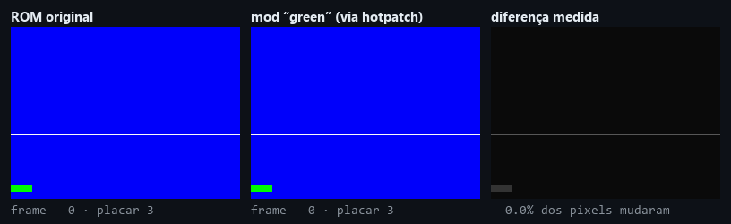
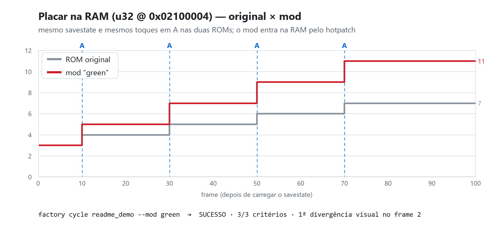

# ds-mods — fábrica de mods e recompilação de Nintendo DS com agentes

<p align="center">
  <a href="https://github.com/frederico-kluser/ds-mods/actions/workflows/ci.yml"></a>
  <a href="https://github.com/frederico-kluser/ds-mods/actions/workflows/codeql.yml"></a>
  <a href="https://securityscorecards.dev/viewer/?uri=github.com/frederico-kluser/ds-mods"></a>
  <a href="LICENSE"></a>
  <a href="https://www.conventionalcommits.org/"></a>
  
  
</p>

> **English summary** — An agent-driven factory for Nintendo DS ROM hacks and matching decompilation.
> Hand it a ROM and a goal: it reverse-engineers the game (dsd, capstone, headless Ghidra, the REA MCP
> server and live GDB on melonDS), writes the mod (armips/NCPatcher/byte and file patches) or the
> byte-matching C (dsd + Metrowerks mwccarm + objdiff), and runs an **autonomous evolution loop**: it
> replays a savestate in BizHawk on the original and the modded ROM (re-applying the mod in RAM),
> records frames, video and RAM watches, scores objective checks and decides whether the mod improved.
> Built for Claude Code (skills + CoALA memory + REA MCP), usable by any coding agent through the
> `factory` CLI. Documentation is in Portuguese.

Você passa a ROM e diz o que quer. O agente (Claude Code ou outro) registra a ROM, faz engenharia
reversa, cria o mod (ou descompila byte a byte) e entra num **ciclo autônomo**: carrega o savestate
no emulador, aperta os mesmos botões na ROM original e no mod, grava frames, vídeo e RAM, compara,
avalia critérios objetivos, olha as imagens e decide se houve evolução — até cumprir o objetivo.

<p align="center">
  
</p>

<p align="center"><sub>Ciclo real da fábrica sobre a ROM homebrew do repositório: mesmo savestate e mesmos toques em A nas
duas ROMs; o mod entra na RAM pelo hotpatch. Gerado por <code>factory selftest-media</code>.</sub></p>

## Como funciona

```
ROM ──► factory new ──► dsd rom extract ──► RE: dis · xrefs · find · ramsearch · Ghidra/REA · GDB ao vivo
                                              │
                   ┌──────────────────────────┴──────────────────────────┐
             Via B: mod (armips · bytes · arquivos · NCPatcher)    Via A: decomp byte a byte (dsd + mwccarm)
                   └──────────────────────────┬──────────────────────────┘
                                factory mod build ──► ROM do mod + hotpatch.json
                                              │
   ┌─────────────────────────── factory cycle <cenário> --mod <m> ───────────────────────────┐
   │ BizHawk (núcleo melonDS) + Lua: carrega o savestate · reaplica o mod na RAM · inputs     │
   │ frames · vídeo · watches de RAM  ──►  baseline (ROM original) × mod, mesmo state/inputs  │
   │ diff por pixel · SSIM · congelamento · tela preta · critérios de RAM e de região da tela │
   │ compare.png / contact.png → o agente olha → SUCESSO · EVOLUIU · ESTÁVEL · REGREDIU …     │
   └───────────────────────────── repete até cumprir o objetivo ─────────────────────────────┘
```

## Instalação

Requisitos: Windows 10/11 x64, Git e (opcional) WSL2 com Ubuntu para o MCP do REA. O bootstrap usa
o Python 3.11+ que existir (ou instala o 3.12 do usuário via winget).

```powershell
git clone https://github.com/frederico-kluser/ds-mods.git
cd ds-mods
powershell -ExecutionPolicy Bypass -File .\bootstrap.ps1 -Wsl -SelfTest
```

O bootstrap cria a `.venv` (dependências com hash), baixa e confere (sha256) o toolchain pinado em
`tools/toolchain.json` para `toolchain/` (fora do git), provisiona o REA no WSL e roda
`factory doctor` e `factory selftest`. No cmd use `factory.cmd`; no Git Bash, `./factory`.

## Como usar

1. Coloque a ROM em `roms\` (ex.: `roms\meujogo.nds`).
2. Abra o Claude Code nesta pasta e peça, por exemplo:
   > Registre `roms\meujogo.nds` e faça um mod em que o personagem não perde vida. Teste no emulador.
3. Se o agente pedir um savestate: rode `.\factory.ps1 play`, jogue até o ponto pedido e aperte
   **F11** (salva checkpoint); **End** fecha. É a única ajuda que ele pode precisar.

Para vídeos que você gravar (OBS, celular…): `.\factory.ps1 analyze C:\caminho\video.mp4` — ou só
diga ao agente onde está o vídeo.

## Comandos principais

```powershell
.\factory.ps1 doctor                       # tudo instalado e funcionando?
.\factory.ps1 selftest                     # teste ponta-a-ponta com uma ROM homebrew própria (~45 s)
.\factory.ps1 new roms\meujogo.nds         # registrar a ROM
.\factory.ps1 info --overlays              # header, SDK, overlays
.\factory.ps1 play                         # jogar; F11 = savestate, F10 = dump de RAM, End = sair
.\factory.ps1 scenario new luta --state play_..._cp01
.\factory.ps1 mod new vida-infinita --template armips
.\factory.ps1 cycle luta --mod vida-infinita --note "nop no decremento de HP"
.\factory.ps1 history vida-infinita
.\factory.ps1 analyze video.mp4 --ref outro.mp4
.\factory.ps1 decomp init                  # Via A (descompilação correspondente)
.\factory.ps1 debug start                  # melonDS + GDB ao vivo; depois:
.\factory.ps1 gdb break 0x02000A08 --wait 20; .\factory.ps1 gdb read 0x02100000 64; .\factory.ps1 gdb continue
```

Todos os comandos: `.\factory.ps1 --help`. O manual do agente é o [`CLAUDE.md`](CLAUDE.md).

## Exemplo funcionando (sem ROM comercial)

O `factory selftest` monta do zero uma ROM homebrew com layout de jogo NitroSDK (secure area, ModuleParams,
ITCM/DTCM, overlay, NitroFS; fontes em [`tools/selftest/`](tools/selftest/)) e passa por toda a fábrica:
extração, mod com hotpatch, runs do boot e de savestate, vídeo, detecção de congelamento, compilador
original, Ghidra headless e GDB ao vivo — 35 verificações. Sobre ela, um ciclo de verdade:

```
.\factory.ps1 selftest-media
=== CICLO #1 · readme_demo · mod=green → SUCESSO ===
expectativas: 3/3 (passou=True) · mudança visual máx 50.0% · 1ª divergência frame 2 · congelamentos 0
RAM: placar: 7.0→11.0
  ✔ no_freeze — 0 congelamento(s) ≥ 2s
  ✔ no_black — 0 frame(s) pretos
  ✔ ram placar == 11 @ end — valor=11.0
```

<p align="center">
  
</p>

## O que tem aqui

| caminho | o quê |
|---|---|
| `tools/factory/` | a CLI `factory` (Python): ROM e NitroFS, emulação, cenários, análise de imagem/vídeo, ciclo, mods, decomp, Ghidra, GDB |
| `tools/lua/factory_runner.lua` | roda dentro do BizHawk: savestate, hotpatch, inputs, capturas, RAM, gravação |
| `tools/ghidra_scripts/` | layout de módulos/overlays, descompilação e sync com o dsd (headless) |
| `tools/selftest/` | a ROM homebrew de teste (armips) |
| `tools/toolchain.json` | toolchain pinado com sha256 (`toolchain.lock.json`: o que está instalado) |
| `tests/` | testes unitários que rodam em qualquer SO (o CI usa Ubuntu); `tests/fuzz/`: fuzzing (atheris) dos parsers de entrada não confiável |
| `.agents/` | skills dos agentes (`nds-visual-loop`, `nds-rea-modder`) e a memória CoALA local |
| `games/`, `roms/` | workspaces por jogo e ROMs do usuário — nada disso é versionado |
| `docs/` | decisões de arquitetura, pesquisa verificada e o guia original |

## Toolchain (pinado em `tools/toolchain.json`, instalado em `toolchain\`, fora do git)

| Ferramenta | Versão | Para quê |
|---|---|---|
| dsd (AetiasHax/ds-decomp) | 0.12.1 | extrair/reconstruir ROM, delink, disassembly, configs de decomp |
| objdiff-cli / GUI | 3.8.3 | diff de objetos e progresso da decomp |
| mwccarm (CodeWarrior DS) | 24 versões | compilador original (match byte a byte) |
| ninja | 1.13.2 | build da decomp |
| BizHawk (EmuHawk + melonDS) | 2.11.1 | emulador automatizado (Lua): inputs, capturas, RAM, savestates |
| melonDS | 1.1 | jogar / depurar com GDB stub |
| armips | 0.11.0 | patches em assembly ARM/THUMB |
| NCPatcher + Fireflower | 1.1.2 / 1.0 | injeção de C/C++ |
| xPack arm-none-eabi-gcc | 15.2.1 | GCC/gdb/objdump para ARM |
| Ghidra + dsd-ghidra + JDK 21 | 11.2.1 / 0.7.0 / 21.0.12 | descompilação (GUI e headless) |
| DeSmuME, neondst | 0.9.13 / 1.0.0 | alternativas |
| REA (WSL) + Ghidra + JDK | 6.7.0 / 12.1.4 / 21 | MCP de engenharia reversa para o agente |
| Python (.venv) | 3.12 | ndspy, capstone, pyelftools, numpy, Pillow, OpenCV, imageio-ffmpeg |

## Decisões e desvios em relação ao guia (verificados em 2026-10-24)

- **Windows nativo para tudo; WSL2 só para o REA**: o provider Ghidra do REA no Windows só aceita PE e
  6502 cru, então o REA (6.7.0) + Ghidra 12.1.4 rodam no WSL e são registrados só neste projeto (`.mcp.json`).
- **BizHawk no ciclo automatizado**: o melonDS standalone não tem scripting; o BizHawk 2.11.1 roda o
  núcleo melonDS com Lua (inputs, capturas, RAM, savestates). O melonDS 1.1 fica para jogar e depurar.
- **Savestate traz o código antigo na RAM**: o runner reaplica o mod (hotpatch) depois do load, com
  guarda por overlay; runs "base" usam a ROM reconstruída pelo dsd (o BizHawk recusa state em ROM de
  tamanho diferente).
- **Ghidra 11.2.1 no Windows** porque o dsd-ghidra 0.7.0 só existe para ela; o loader dele abre um
  diálogo modal no modo headless, então a fábrica usa um script de layout próprio.
- **GDB ao vivo por uma ponte própria**: o stub do melonDS 1.1 só atende a primeira conexão de cada
  execução e trava o `arm-none-eabi-gdb` no handshake.
- Detalhes, alternativas e evidências: [`docs/decisoes.md`](docs/decisoes.md) e
  [`docs/pesquisa-verificada.md`](docs/pesquisa-verificada.md).

## Documentação

- [`CLAUDE.md`](CLAUDE.md) — manual de operação do agente (o `AGENTS.md` aponta para ele).
- [`.agents/skills/nds-visual-loop/SKILL.md`](.agents/skills/nds-visual-loop/SKILL.md) — ciclo emulador → captura → análise → decisão.
- [`.agents/skills/nds-rea-modder/SKILL.md`](.agents/skills/nds-rea-modder/SKILL.md) — RE, Via A (decomp), Via B (mods), REA.
- [`docs/guia-original.md`](docs/guia-original.md) — o guia que originou o projeto.
- `.agents/ds-mods-coala-agent-skill/` — memória CoALA do projeto; o git versiona as notas no dump
  `memory/coala.canonical.jsonl` (`factory memory dump` antes de commitar; o `bootstrap.ps1` restaura).

## Contribuindo

Contribuições são bem-vindas! Leia o [CONTRIBUTING.md](CONTRIBUTING.md) (ambiente, branches
`<tipo>/<slug>`, Conventional Commits, testes) e o [Código de Conduta](CODE_OF_CONDUCT.md). Dúvidas e
ideias: [Discussions](https://github.com/frederico-kluser/ds-mods/discussions).

## Segurança

Não reporte vulnerabilidades em issues públicas — veja o [SECURITY.md](SECURITY.md) (Private
Vulnerability Reporting).

## Versionamento

[SemVer](https://semver.org/lang/pt-BR/) calculado a partir dos commits; o release-please mantém o PR de
release e o [CHANGELOG.md](CHANGELOG.md).

## Legal

Use apenas ROMs e BIOS de cópias que você possui. Nada derivado de jogos comerciais é versionado (ROMs,
BIOS, savestates, extrações, builds, frames, vídeos, projetos do Ghidra). Para compartilhar um mod,
distribua o `mod.json` e os patches (`.asm`, C/C++), não a ROM.

## Licença e créditos

Código deste repositório sob a licença [MIT](LICENSE). O `factory setup` baixa das fontes oficiais, sem
redistribuir, ferramentas com licenças próprias (dsd, objdiff, BizHawk, melonDS, armips, NCPatcher,
Ghidra, dsd-ghidra, Temurin, REA, os compiladores Metrowerks e outras) — a lista completa, com as
licenças, está em [THIRD_PARTY_NOTICES.md](THIRD_PARTY_NOTICES.md), junto do texto MIT do dsd-ghidra
(base do `FactorySyncDsd.java`). A memória CoALA (`.agents/ds-mods-coala-agent-skill`, motor `coala.py`
incluído) vem da coala-agent-skill do mesmo autor, também sob MIT.
